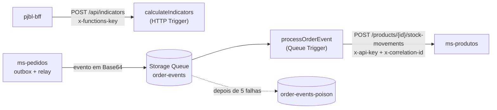

# pjbl-function — Azure Functions da Conecta Store

Parte *serverless* do nosso trabalho PJBL de arquitetura distribuída. A **Conecta Store** é um sistema de
gestão de produtos/estoque e pedidos dividido em microfrontend, API Gateway, BFF, dois microserviços e esta
Function App. Aqui ficam duas funções:

- **`calculateIndicators` (HTTP Trigger)** — o BFF manda os produtos e pedidos que buscou nos microserviços
  e a Function devolve os indicadores do painel (valor do estoque, estoque baixo, faturamento, ticket médio,
  produtos mais vendidos e alertas).
- **`processOrderEvent` (Queue Trigger / Message Trigger)** — consome os eventos de pedido que o ms-pedidos
  publica na fila e dá baixa (ou devolve) o estoque no ms-produtos. É a parte *event-driven* do projeto.

## Arquitetura



O fluxo completo do sistema é **Microfrontend → API Gateway → BFF → (ms-produtos, ms-pedidos, Azure Function)**.
A Function nunca é chamada direto pelo front.

### Como o evento vira movimentação de estoque

| Evento | O que a Function faz |
|---|---|
| `order.created` | uma **SAÍDA** por item do pedido |
| `order.cancelled` | uma **ENTRADA** por item (devolução) |

Cada movimentação vai com `eventId = "<eventId>:<productId>"`. Como a fila entrega *pelo menos uma vez*, a
mesma mensagem pode chegar repetida; o ms-produtos tem um índice único nesse campo e responde
`200 duplicate: true` em vez de baixar o estoque de novo. É isso que deixa o consumidor idempotente.

Tratamento de erros do consumidor:

| Situação | O que acontece |
|---|---|
| Mensagem que não é JSON ou está fora do contrato | loga o motivo e descarta (reprocessar não ia consertar) |
| `404` / `409` do ms-produtos (produto removido, estoque insuficiente) | *warning* no log, segue para os outros itens e não reprocessa |
| Falha de rede, timeout, `5xx`, `429` | a exceção sobe, o runtime reentrega a mensagem; depois de 5 tentativas ela vai para `order-events-poison` |
| Outra resposta inesperada (`400`, `401`...) | também relança — preferimos a mensagem parada na fila *poison* do que sumindo sem ninguém ver |

Se a falha acontecer no meio do pedido (um item aplicado e o outro não), a reentrega completa o que faltou e
o item já aplicado volta como duplicado.

## Tecnologias

- Node.js 22 (na nuvem) + TypeScript 5.9
- Azure Functions, *programming model* v4 (`@azure/functions`)
- Azure Storage Queue (gatilho de fila) — localmente, Azurite
- zod para validar as entradas
- Vitest para os testes (unitários, integração e arquitetura)
- GitHub Actions para CI e deploy

## Estrutura de pastas

Mesma disciplina dos outros serviços do projeto: Clean Architecture em quatro camadas, com as features
organizadas em *vertical slices* (uma pasta por caso de uso).

```
src/
  domain/                      # regras puras, sem nenhum pacote
    indicators.ts              #   cálculo dos indicadores e alertas
    orderEvent.ts              #   tradução evento → movimentações de estoque
    money.ts, errors.ts
  application/
    ports/                     # StockGateway (ms-produtos) e Logger
    features/
      CalculateIndicators/CalculateIndicators.ts   # schema zod + CalculateIndicatorsHandler
      ProcessOrderEvent/ProcessOrderEvent.ts       # schema zod + ProcessOrderEventHandler
    validation.ts              # validate(schema, input) → ValidationError { field, message }[]
  infrastructure/
    ProdutosHttpStockGateway.ts  # cliente HTTP do ms-produtos (fetch, timeout, x-api-key, x-correlation-id)
    config.ts                    # leitura das app settings
  api/                         # adaptadores finos das functions
    features/
      CalculateIndicators/CalculateIndicatorsEndpoint.ts
      ProcessOrderEvent/ProcessOrderEventEndpoint.ts
    health.ts, openapi.ts, docs.ts, http.ts, invocationLogger.ts
  main.ts                      # composition root: monta tudo e registra com app.http / app.storageQueue
tests/
  unit/           # domínio, casos de uso (com gateway falso) e adaptadores
  integration/    # cliente HTTP contra um ms-produtos falso em node:http
  architecture/   # dependencyScanner.ts + rules.ts + architecture.test.ts
```

Regras que os testes de arquitetura garantem: o `domain` não importa nada; a `application` só conhece o
`domain` e o `zod`; a `api` não importa a `infrastructure` (quem liga as duas é o `main.ts`); o SDK
`@azure/functions` só aparece na `api` e no `main.ts`; uma feature não importa outra; toda feature tem o
`<Feature>.ts` com a classe `<Feature>Handler` e o `<Feature>Endpoint.ts`.

## Funções e rotas

| Função | Gatilho | Rota | Autenticação |
|---|---|---|---|
| `calculateIndicators` | HTTP POST | `/api/indicators` | `authLevel: function` (cabeçalho `x-functions-key`) |
| `processOrderEvent` | Storage Queue `order-events` | — | conexão `AzureWebJobsStorage` |
| `health` | HTTP GET | `/api/health` | anônimo |
| `openapi` | HTTP GET | `/api/openapi.json` | anônimo |
| `docs` | HTTP GET | `/api/docs` (Swagger UI) | anônimo |

`POST /api/indicators` recebe `{ "products": [...], "orders": [...] }` (os objetos como vêm dos
microserviços; campos extras são ignorados) e devolve:

```json
{
  "products": { "total": 3, "totalUnitsInStock": 15, "inventoryValue": 403.8,
                "lowStock": [{ "id": "...", "sku": "FILTRO-103", "name": "Filtro de papel 103", "stock": 0 }],
                "outOfStock": 1,
                "byCategory": [{ "category": "Mercearia", "count": 2, "units": 12, "value": 298.8 }] },
  "orders": { "total": 3, "byStatus": { "PENDENTE": 1, "PAGO": 1, "ENVIADO": 0, "ENTREGUE": 0, "CANCELADO": 1 },
              "revenue": 84.8, "averageTicket": 84.8, "pendingValue": 24.9, "cancellationRate": 0.33 },
  "topProducts": [{ "productId": "...", "productName": "Café torrado 500g", "quantity": 3, "revenue": 74.7 }],
  "alerts": ["2 produtos estão com estoque baixo.", "1 produto está zerado no estoque."],
  "generatedAt": "2025-06-10T14:30:00.000Z",
  "computedBy": "azure-function"
}
```

Algumas regras do cálculo:

- `lowStock` = produtos com 5 unidades ou menos (mesma régua do ms-produtos; os zerados entram e também são contados em `outOfStock`);
- `revenue` = pedidos `PAGO` + `ENVIADO` + `ENTREGUE`; `averageTicket` = `revenue` dividido pela quantidade desses pedidos;
- `pendingValue` = soma dos `PENDENTE`; `cancellationRate` = cancelados ÷ total (0 a 1);
- `topProducts` = 5 produtos com mais unidades vendidas, sem contar pedidos cancelados;
- o alerta de cancelamento aparece quando a taxa passa de 20%;
- dinheiro e taxas arredondados em 2 casas.

Corpo inválido devolve `400` no formato de erro padrão do projeto
(`{ "error": { "code", "message", "details", "correlationId" } }`), com `INVALID_JSON` ou `VALIDATION_ERROR`.
O `x-correlation-id` recebido volta na resposta; se não vier, a Function gera um.

## App settings

| Nome | Para que serve | Exemplo |
|---|---|---|
| `AzureWebJobsStorage` | Storage Account do runtime e da fila | `UseDevelopmentStorage=true` (local, Azurite) |
| `FUNCTIONS_WORKER_RUNTIME` | runtime do worker | `node` |
| `PRODUTOS_API_URL` | URL base do ms-produtos | `http://localhost:3001` |
| `PRODUTOS_API_KEY` | chave enviada em `x-api-key` (igual à `INTERNAL_API_KEY` do ms-produtos) | — |
| `ORDER_EVENTS_QUEUE` | nome da fila de eventos | `order-events` (padrão) |
| `PRODUTOS_API_TIMEOUT_MS` | opcional, timeout da chamada ao ms-produtos | `8000` (padrão) |

Nenhum valor real fica no repositório: o `local.settings.json` está no `.gitignore` e só o
`local.settings.example.json` (com valores fictícios) é versionado.

## Como rodar localmente

Pré-requisitos: Node.js 20 ou mais novo, **Azure Functions Core Tools v4** e **Azurite** (emulador do Storage).

### Instalando o Core Tools e o Azurite

O jeito mais simples no Windows é o instalador do Core Tools
(`winget install Microsoft.Azure.FunctionsCoreTools`) e o Azurite pelo npm (`npm install -g azurite`).

Se preferir instalar o Core Tools pelo npm, atenção: no **npm 11** os scripts de `postinstall` vêm bloqueados
e o pacote `azure-functions-core-tools` depende de um para baixar o binário. A flag `--allow-scripts` não
funcionou em instalação local; o que resolveu foi criar uma pasta de ferramentas com um `package.json`
liberando o pacote:

```json
{
  "name": "pjbl-tools",
  "private": true,
  "allowScripts": { "azure-functions-core-tools": true }
}
```

```powershell
# dentro da pasta de ferramentas (ex.: C:\pjbl-tools)
npm install azure-functions-core-tools@4 azurite
$env:Path = "C:\pjbl-tools\node_modules\.bin;$env:Path"   # deixa func e azurite disponíveis neste terminal
```

### Subindo a Function

```powershell
npm install
Copy-Item local.settings.example.json local.settings.json   # ajuste PRODUTOS_API_URL / PRODUTOS_API_KEY se precisar

# terminal 1 — emulador do Storage (a fila fica na porta 10001)
azurite --silent --location .\azurite-data

# terminal 2 — compila e sobe o runtime
npm start
```

O `npm start` roda o build (`prestart`) e depois o `func start`. Com tudo no ar:

- Swagger: <http://localhost:7071/api/docs>
- Health: <http://localhost:7071/api/health>

Rodando local a chave de função não é cobrada, então dá para testar direto:

```powershell
curl.exe -X POST http://localhost:7071/api/indicators -H "content-type: application/json" `
  -d '{\"products\":[{\"id\":\"p1\",\"sku\":\"CAFE-500G\",\"name\":\"Cafe\",\"category\":\"Mercearia\",\"price\":24.9,\"stock\":3}],\"orders\":[]}'
```

Para ver o Queue Trigger funcionando, suba também o ms-produtos (porta 3001) e o ms-pedidos com
`QUEUE_CONNECTION_STRING=UseDevelopmentStorage=true`. Ao criar um pedido, o evento cai na fila `order-events`,
a Function loga o processamento e o estoque do produto baixa; cancelando o pedido, o estoque volta.

## Testes

```powershell
npm test            # tudo: unitários, integração e arquitetura (85 testes)
npm run test:arch   # só os testes de arquitetura
npm run typecheck   # checagem de tipos sem gerar arquivos
```

O que é coberto:

- **Domínio**: cálculo dos indicadores (listas vazias, arredondamento, estoque baixo, categorias, top 5
  ignorando cancelados, alertas no singular/plural) e a tradução dos eventos em movimentações.
- **Casos de uso**, com um ms-produtos falso em memória: idempotência (mesma mensagem duas vezes), `404`/`409`
  sem relançar, `5xx` relançando, falha no meio do pedido, mensagem inválida descartada, mensagem como objeto,
  texto ou Base64.
- **Adaptadores**: o endpoint HTTP é testado com o `HttpRequest` e o `InvocationContext` de verdade do SDK
  `@azure/functions`; health, OpenAPI (inclusive se todo `$ref` existe) e a página do Swagger.
- **Integração**: o cliente HTTP chama um servidor `node:http` que finge ser o ms-produtos (rota, corpo,
  cabeçalhos, `201`/`200`/`404`/`409`/`5xx`/`429`, timeout e conexão recusada).
- **Arquitetura**: o `tests/architecture/dependencyScanner.ts` lê os `.ts` de `src/`, extrai os imports por
  regex e as regras de `rules.ts` conferem as dependências entre camadas e features.

### Vendo um teste de arquitetura falhar

Para provar que as regras pegam violação de verdade, coloque esta linha no topo de `src/domain/money.ts`:

```ts
import { app } from '@azure/functions';
```

e rode `npm run test:arch`. Dois testes falham, com a mensagem:

```
domain/money.ts (domain) não pode usar o pacote "@azure/functions"
domain/money.ts (domain) não pode importar "@azure/functions"
```

Depois é só apagar a linha e os testes voltam a passar.

## Deploy

A Function App roda no plano **Flex Consumption** (o Linux Consumption antigo está sendo aposentado), com
Node 22. Nesse plano o runtime é escolhido na criação do app (`--runtime node --runtime-version 22`).
As demais app settings da tabela acima precisam ser configuradas no app (portal ou `az functionapp config appsettings set`).

### GitHub Actions

O workflow `.github/workflows/ci.yml` tem dois jobs:

1. **test** — `npm ci`, typecheck, testes e build, em todo push e pull request;
2. **deploy** — só em push na `main`, publica com `Azure/functions-action@v1`.

Para o deploy funcionar, configure no repositório (Settings → Secrets and variables → Actions):

- variável `AZURE_FUNCTIONAPP_NAME`: nome da Function App;
- secret `AZURE_FUNCTIONAPP_PUBLISH_PROFILE`: conteúdo do *publish profile* baixado no portal do Azure
  (precisa da opção "SCM Basic Auth Publishing Credentials" ligada no app).

Se algum dos dois não estiver definido, o job não quebra: ele só avisa com um *warning* e pula a publicação.

### Pela linha de comando

```powershell
npm ci
npm run build
func azure functionapp publish <nome-da-function-app>
```

O `.funcignore` deixa de fora `src/`, `tests/` e os arquivos de configuração; sobem `dist/`, `host.json`,
`package.json` e `node_modules`.

Depois do deploy, a chave que o BFF precisa (`FUNCTION_KEY`) está no portal em *App keys*, e a `FUNCTION_URL`
do BFF é `https://func-pjbl-0a42b2.azurewebsites.net/api`.

## Links na nuvem

- Swagger da Function: https://func-pjbl-0a42b2.azurewebsites.net/api/docs
- Health: https://func-pjbl-0a42b2.azurewebsites.net/api/health
- OpenAPI (JSON): https://func-pjbl-0a42b2.azurewebsites.net/api/openapi.json

Outros repositórios do projeto:

- Microfrontend: https://github.com/devinigarcia/pjbl-microfrontend
- BFF: https://github.com/devinigarcia/pjbl-bff
- ms-produtos: https://github.com/devinigarcia/pjbl-ms-produtos
- ms-pedidos: https://github.com/devinigarcia/pjbl-ms-pedidos
- Arquitetura (ARC42, C4, contratos): https://github.com/devinigarcia/pjbl-arquitetura

## Alunos

- Arthur Ambrozewicz Cidral
- Erick Marlon Barbieri da Silva
- Luan Alberti Estevinho
- Vinícius de Oliveira Garcia
